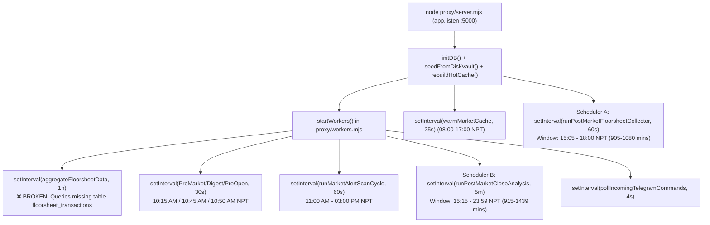

# DRABYASHREE NEPSE — PHASE 2: AUTOMATIC DAILY DATA COLLECTION AUDIT REPORT

**Generated At:** `2026-10-30T23:25:00+05:45` (Nepal Standard Time)  
**Target Workspace:** `C:\Users\Hp\Desktop\Software\nepse app`  
**Modules Audited:** [`proxy/server.mjs`](file:///c:/Users/Hp/Desktop/Software/nepse%20app/proxy/server.mjs#L12442-L12498), [`proxy/workers.mjs`](file:///c:/Users/Hp/Desktop/Software/nepse%20app/proxy/workers.mjs#L1-L681), [`proxy/utils/dailyFloorsheetCollector.mjs`](file:///c:/Users/Hp/Desktop/Software/nepse%20app/proxy/utils/dailyFloorsheetCollector.mjs#L1-L403), [`proxy/brokerVault.mjs`](file:///c:/Users/Hp/Desktop/Software/nepse%20app/proxy/brokerVault.mjs#L2329-L2600), [`proxy/db/ledgerStore.js`](file:///c:/Users/Hp/Desktop/Software/nepse%20app/proxy/db/ledgerStore.js#L195-L380), [`src/utils/nepseCalendar.js`](file:///c:/Users/Hp/Desktop/Software/nepse%20app/src/utils/nepseCalendar.js#L1-L340)  
**Audit Mode:** Strictly Read-Only Code & Runtime Inspection  

---

## 1. EXECUTIVE SUMMARY

Drabyashree configures **two overlapping background post-market collection loops** inside the Node.js Express backend (`proxy/server.mjs` and `proxy/workers.mjs`) that run independently of the React/Capacitor frontend. However, a systematic inspection against all 14 required daily collection criteria reveals **8 critical/high architectural defects (`P2-1` through `P2-8`)** that cause race conditions, overwrite clean equity-filtered data with unfiltered Mutual Fund/Debenture data, fail to resume incomplete pagination, fail to catch up on missed historical trading days, and leave `HOT_CACHE` stale after collection.

| Audit Criterion | Status | Summary Verdict |
|---|---|---|
| **1. Background scheduler configured?** | **PASS (With Race Condition)** | Two `setInterval` schedulers exist (`server.mjs` at 15:05 NPT & `workers.mjs` at 15:15 NPT), plus `startWorkers()`. |
| **2. Runs independently of frontend?** | **PASS** | Runs inside the Node.js backend daemon (`node proxy/server.mjs`), requiring zero browser/APK interaction. |
| **3. Uses Nepal Standard Time (`Asia/Kathmandu`)?** | **PARTIAL (`P2-5`)** | `nepseCalendar.js` uses `UTC + 05:45`, **but** `workers.mjs` line 47/58 uses SQLite `CURRENT_DATE` (UTC!), shifting midnight by 5h 45m. |
| **4. Recognizes NEPSE trading days?** | **PASS** | Calls `isNepseTradingDay()` (`Mon–Fri`, excluding `Sat/Sun`). |
| **5. Avoids collection on confirmed holidays?** | **PARTIAL (`P1-2`)** | Checks `isNepsePublicHoliday()`, **but** 3 separate hardcoded holiday maps exist across `server.mjs`, `nepseCalendar.js`, and `ledgerStore.js` with conflicting dates. |
| **6. Triggers at appropriate time after session?** | **DEFECTIVE (`P2-1`)** | **Dual competing triggers:** Loop A fires at `15:05 NPT` (`server.mjs:12480`) and Loop B fires at `15:15 NPT` (`workers.mjs:636`) with **no shared mutex**. |
| **7. Waits for source data availability?** | **PARTIAL** | Verifies `sampleFreshDate === targetDate` (`dailyFloorsheetCollector.mjs:275`), aborting if NOTS still serves yesterday's session. |
| **8. Retries failed requests?** | **PARTIAL (`P2-2`)** | Per-page retry (`maxRetries: 3`, exponential backoff `300ms -> 600ms -> 1200ms`), **but** if a page still fails after 3 retries, `catch (_)` swallows the error and continues! |
| **9. Resumes incomplete pagination?** | **FAIL (`P2-2`)** | **No page-level resume.** Worse: if `< 98%` of `totalElements` is downloaded, `getFullSessionFloorsheet` still returns the partial array, and `dailyFloorsheetCollector.mjs` writes `floorsheet-YYYY-MM-DD.json` with `status: 'COMPLETE'`, permanently blocking future retries! |
| **10. Detects previously missed trading dates?** | **FAIL (`P2-3`)** | **Zero catch-up mechanism.** Both schedulers only check `todayIso`. If the server is offline between `15:05–23:59 NPT` on a trading day (like `2026-09-21` or `2026-10-29`), it never checks prior trading dates on subsequent days. |
| **11. Prevents duplicate collection?** | **FAIL (`P2-1`)** | `runPostMarketFloorsheetCollector` (`server.mjs`) and `runPostMarketCloseAnalysis` (`workers.mjs`) do not share a lock (`isPostMarketAnalysisRunning` is local to `workers.mjs`), causing duplicate 70,000-row downloads and double SQLite writes on the same day. |
| **12. Records date and time of each collection?** | **PARTIAL (`P2-4`)** | `getFullSessionFloorsheet` logs to `daily_ingestion_log` (`nepse_ledger.sqlite`), whereas `dailyFloorsheetCollector` logs to `archive_index.json` without updating `daily_ingestion_log` (leaving `2026-10-30` missing from `daily_ingestion_log`). |
| **13. Survives backend restarts?** | **PARTIAL (`P2-6`)** | `server.mjs:12497` runs a startup check after `10s`, ** only if restarted between `15:05` and `18:00 NPT`**. Meanwhile `lastPostMarketSessionAnalyzed` in `workers.mjs:317` is an in-memory variable that resets to `null` on every restart, re-running `runPostMarketCloseAnalysis()` on any restart between `15:15` and `23:59 NPT`! |
| **14. Reports collection failures?** | **PARTIAL (`P2-7`)** | Logs `console.warn` and writes `PARTIAL_WARNING` to `daily_ingestion_log`, **but** `aggregateFloorsheetData()` (`workers.mjs:29`) crashes every hour on a non-existent table (`floorsheet_transactions`), and collection failures never notify Telegram/Discord or the UI. |

---

## 2. STEP-BY-STEP INSPECTION OF THE 14 SCHEDULER CRITERIA

### 2.1 Scheduler Architecture & Independence (Criteria 1 & 2)
When `node proxy/server.mjs` starts (`app.listen` at [`proxy/server.mjs` line 12368](file:///c:/Users/Hp/Desktop/Software/nepse%20app/proxy/server.mjs#L12368)), it initializes the database, seeds the disk vault, builds `HOT_CACHE`, and starts **two separate post-market schedulers** plus **four intraday/pre-market workers**:



- **Independence from Frontend:** Both Scheduler A (`runPostMarketFloorsheetCollector`) and Scheduler B (`runPostMarketCloseAnalysis`) execute inside the backend Node process. Furthermore, on Render production (`process.env.NODE_ENV === 'production' || process.env.RENDER`), [`proxy/server.mjs` lines 12432–12440](file:///c:/Users/Hp/Desktop/Software/nepse%20app/proxy/server.mjs#L12432-L12440) runs a 12-minute keep-alive self-ping (`GET /api/ping`) so the free-tier container does not sleep.

---

### 2.2 Timezone & NEPSE Trading Calendar Recognition (Criteria 3, 4, 5)
- **Nepal Standard Time (`UTC+05:45`):**
  - [`src/utils/nepseCalendar.js` (lines 70–88)](file:///c:/Users/Hp/Desktop/Software/nepse%20app/src/utils/nepseCalendar.js#L70-L88) computes NPT by adding `(5 * 60 + 45) * 60 * 1000` ms (`20,700,000` ms) to UTC epoch and reading `getUTCDay()`, `getUTCHours()`, and `getUTCMinutes()`.
  - **Defect `P2-5` (UTC SQLite `CURRENT_DATE` & `new Date().toISOString()`):**
    1. In [`proxy/workers.mjs` lines 47 & 58](file:///c:/Users/Hp/Desktop/Software/nepse%20app/proxy/workers.mjs#L47-L58), `aggregateFloorsheetData()` filters `WHERE traded_date = CURRENT_DATE`. In SQLite, `CURRENT_DATE` evaluates in **UTC**, which is one day behind NPT between `00:00 AM` and `05:45 AM NPT`!
    2. In [`proxy/brokerVault.mjs` line 2301](file:///c:/Users/Hp/Desktop/Software/nepse%20app/proxy/brokerVault.mjs#L2301), fallback `sessionDt` uses `new Date().toISOString().split('T')[0]` (UTC) instead of NPT.
- **Holiday & Trading Day Recognition:**
  - Both schedulers call `isNepseTradingDay()` from [`src/utils/nepseCalendar.js`](file:///c:/Users/Hp/Desktop/Software/nepse%20app/src/utils/nepseCalendar.js#L130-L140), which returns `false` on Saturdays (`day === 6`), Sundays (`day === 0`), and dates in `NEPSE_PUBLIC_HOLIDAYS`.
  - **Defect `P1-2` / `P2-5` (Three Divergent Holiday Maps):**
    1. [`src/utils/nepseCalendar.js`](file:///c:/Users/Hp/Desktop/Software/nepse%20app/src/utils/nepseCalendar.js#L21-L65) defines `NEPSE_PUBLIC_HOLIDAYS`.
    2. [`proxy/db/ledgerStore.js`](file:///c:/Users/Hp/Desktop/Software/nepse%20app/proxy/db/ledgerStore.js#L430-L446) defines a separate `NEPSE_PUBLIC_HOLIDAYS` object (where `2026-09-17` is Indra Jatra instead of `2026-09-25`).
    3. [`proxy/server.mjs`](file:///c:/Users/Hp/Desktop/Software/nepse%20app/proxy/server.mjs#L579-L619) defines a third `NEPSE_HOLIDAYS_MAP` object!

---

### 2.3 Competing Post-Market Triggers & Dual-Ingestion Collision (Criteria 6 & 11 — Bug `P2-1`)
On every trading day after `15:00 NPT` (market close), **two independent schedulers fire within 10 minutes of each other** and overwrite each other's SQLite data using incompatible ingestion functions:

1. **At `15:05 NPT` (`nptMins >= 905`):**
   - **Scheduler A (`runPostMarketFloorsheetCollector` in [`proxy/server.mjs:12470`](file:///c:/Users/Hp/Desktop/Software/nepse%20app/proxy/server.mjs#L12470))** checks `archive_index.json`. Finding no entry for `todayIso`, it calls `downloadAndArchiveDailyFloorsheet(todayIso)`.
   - Inside [`downloadAndArchiveDailyFloorsheet(todayIso)`](file:///c:/Users/Hp/Desktop/Software/nepse%20app/proxy/utils/dailyFloorsheetCollector.mjs#L266):
     - Step 1: Calls `getFullSessionFloorsheet(todayIso)` (`brokerVault.mjs:2329`), which downloads all pages from NEPSE NOTS, saves `proxy/data/floorsheet-full-${todayIso}.json`, calls **`ingestDailyFloorsheetTransaction(todayIso, deduplicatedTrades)`** (which **filters out** 95 Mutual Funds/Debentures and computes **Chronological Tick-Test** `aggressor_side` and sets `source = 'NOTS_FULL_DUMP'`), and calls **`rebuildHotCache()`**.
     - Step 2: Immediately after `getFullSessionFloorsheet` returns `trades`, `downloadAndArchiveDailyFloorsheet` (at line 337) calls **`ingestContractsToLedger(todayIso, trades)`**, which **overwrites** `floorsheet_contracts`, `daily_broker_ledger`, and `daily_stock_summary` with **unfiltered** Mutual Funds/Debentures (`348–360` scrips), overwrites `aggressor_side` with `bBroker > sBroker ? 'BUY' : 'SELL'`, overwrites `open_price`/`close_price` without sorting chronologically, sets `source = 'DAILY_COLLECTOR'`, and **does NOT call `rebuildHotCache()`**!
2. **At `15:15 NPT` (`nptMins >= 915`):**
   - **Scheduler B (`runPostMarketCloseAnalysis` in [`proxy/workers.mjs:349`](file:///c:/Users/Hp/Desktop/Software/nepse%20app/proxy/workers.mjs#L349))** fires:
     - Step 1: Calls `syncDailyFloorsheetAndPrices(targetDate)`:
       - Calls `ingestDailyStockPrices(targetDate, todayPrices)` (from ShareSansar `/today-share-price` or cache), updating `daily_stock_summary`.
       - Calls `getFullSessionFloorsheet(targetDate)` (which reads the cached file from disk).
     - Step 2: Calls `downloadAndArchiveDailyFloorsheet(targetDate)` again (which sees `floorsheet-${targetDate}.json` already on disk and returns `{ cached: true }`).
     - Step 3: Calls `aggregateFloorsheetData()` (`workers.mjs:29`), which **fails with a SQL error** because table `floorsheet_transactions` does not exist!
     - Step 4: Calls `runFullUniversePrimePick()`.
   - Furthermore, if the 15:05 download takes longer than 60 seconds (e.g., 140 pages * 500 trades = 70,000 trades taking ~75 seconds), **Scheduler A (`setInterval(..., 60000)`) has no `isRunning` lock** (`alreadyArchived` in `archive_index.json` is only written at the very end of `downloadAndArchiveDailyFloorsheet`), so **Scheduler A triggers a second concurrent download at `15:06 NPT` while the `15:05 NPT` download is still mid-flight!**

---

### 2.4 Pagination Failure Handling, Partial Downloads & Lack of Resume (Criteria 7, 8, 9 — Bug `P2-2`)
We traced what happens when NEPSE NOTS drops a page or times out mid-download inside [`getFullSessionFloorsheet()` (`proxy/brokerVault.mjs:2462-2518`)](file:///c:/Users/Hp/Desktop/Software/nepse%20app/proxy/brokerVault.mjs#L2462-L2518):

1. Page `0` returns `totalElements` (e.g., `69,619` on `2026-10-29`, `totalPages = 140`).
2. Pages `1..139` are fetched sequentially with `fetchWithRetryBackoff(..., { maxRetries: 3, initialDelayMs: 300, backoffFactor: 2 })`.
3. **Silent Page Drop (`brokerVault.mjs:2482`):**
   ```js
   } catch (_) {}
   ```
   If any page `p` fails all 3 retries (e.g., temporary NOTS 502/timeout or token expiration), the `catch (_)` block **silently swallows the error** and moves to page `p + 1`.
4. **98% Completeness Threshold Bypassed by `dailyFloorsheetCollector.mjs`:**
   - At [`brokerVault.mjs` line 2508](file:///c:/Users/Hp/Desktop/Software/nepse%20app/proxy/brokerVault.mjs#L2508):
     ```js
     if ((!cleanDate || recDate === cleanDate) && deduplicatedTrades.length >= totalElements * 0.98) {
       // Only writes floorsheet-full-YYYY-MM-DD.json if >= 98%!
     }
     if (!cleanDate || recDate === cleanDate) {
       return deduplicatedTrades; // <--- RETURNS PARTIAL TRADES EVEN IF < 98%!
     }
     ```
   - On `2026-10-29`, `66,500` unique contracts were retrieved out of `69,619` (`96.41% < 98%`). Therefore, `getFullSessionFloorsheet` **refused** to write `floorsheet-full-2026-10-29.json` and logged `PARTIAL_WARNING` in `daily_ingestion_log`, **but still returned the partial `66,500`-row array to `downloadAndArchiveDailyFloorsheet()`**!
   - Then `downloadAndArchiveDailyFloorsheet()` ([`dailyFloorsheetCollector.mjs:330-355`](file:///c:/Users/Hp/Desktop/Software/nepse%20app/proxy/utils/dailyFloorsheetCollector.mjs#L330-L355)) blindly ingested those `66,500` partial rows into `floorsheet_contracts` and `daily_broker_ledger` and marked `archive_index.json` as `status: 'COMPLETE'`!
   - Worse still, because `floorsheet_contracts` now had `66,500 > 0` rows for `2026-10-29`, every subsequent call to `getFullSessionFloorsheet('2026-10-29')` hits lines `2373–2388` (`SELECT ... FROM floorsheet_contracts WHERE trade_date = ?`) and returns the `66,500` partial rows from SQLite without ever retrying the missing pages!

---

### 2.5 Missing Historical Catch-Up Mechanism (Criterion 10 — Bug `P2-3`)
- **Expected Requirement:** *"Create a catch-up mechanism that detects missed trading dates and attempts to retrieve missing historical data."*
- **Actual Implementation:**
  - At startup, [`seedFromDiskVault()`](file:///c:/Users/Hp/Desktop/Software/nepse%20app/proxy/db/ledgerStore.js#L195-L380) only scans **local files already on disk** (`floorsheet-full-*.json` and `broker_vault/*.json`) and checks if their dates exist in SQLite.
  - Neither `seedFromDiskVault()`, `runPostMarketFloorsheetCollector()`, nor `runPostMarketCloseAnalysis()` generates the expected NEPSE trading calendar for the last 30 days to check if any past trading session is **missing from both disk and SQLite** (such as `2026-09-21`) or **flagged as `PARTIAL_WARNING` in `daily_ingestion_log`** (such as `2026-10-29` and `2026-10-26`).

---

### 2.6 Dead SQL Worker `aggregateFloorsheetData()` in `proxy/workers.mjs` (Criterion 14 — Bug `P2-7`)
- At [`proxy/workers.mjs` lines 29–89](file:///c:/Users/Hp/Desktop/Software/nepse%20app/proxy/workers.mjs#L29-L89) (called every 60 minutes by `setInterval(aggregateFloorsheetData, 60 * 60 * 1000)` at line 560 and after market close at line 381):
  ```sql
  INSERT INTO broker_daily_accumulation (...)
  WITH buys AS (
    SELECT ... FROM floorsheet_transactions WHERE traded_date = CURRENT_DATE ...
  )
  ```
- We inspected `proxy/db.mjs` (`nepse_cache.sqlite`) and `proxy/db/ledgerStore.js` (`nepse_ledger.sqlite`):
  - **Neither database defines a table named `floorsheet_transactions` or `broker_daily_accumulation`, and SQLite (`3.x` in `db.mjs`) syntax is incompatible with PostgreSQL `FULL OUTER JOIN` in older SQLite versions.**
  - Every hour (and on every post-market run), `aggregateFloorsheetData()` throws `SQLITE_ERROR: no such table: floorsheet_transactions`!

---

### 2.7 Missing `rebuildHotCache()` After Daily Collection (Required Workflow Step 8/9 — Bug `P2-8`)
- Look at the required daily workflow:
  `Store records with trading date → Reconcile collected records → Update stock-level data → Refresh relevant service calculations`
- In [`proxy/db/ledgerStore.js`](file:///c:/Users/Hp/Desktop/Software/nepse%20app/proxy/db/ledgerStore.js#L898-L1085), all fast institutional Radar, Smart Money Flow, and Telemetry endpoints read from the in-memory `HOT_CACHE` (`HOT_CACHE.dates`, `HOT_CACHE.windowAggregates['1']`, `HOT_CACHE.windowAggregates['5']`, etc.), which is populated ONLY when `rebuildHotCache()` is called.
- However:
  - When `downloadAndArchiveDailyFloorsheet()` finishes `ingestContractsToLedger()` ([`dailyFloorsheetCollector.mjs:337`](file:///c:/Users/Hp/Desktop/Software/nepse%20app/proxy/utils/dailyFloorsheetCollector.mjs#L337)), it **never calls `rebuildHotCache()`**!
  - When `syncDailyFloorsheetAndPrices()` finishes `ingestDailyStockPrices()` ([`workers.mjs:331`](file:///c:/Users/Hp/Desktop/Software/nepse%20app/proxy/workers.mjs#L331)), it **never calls `rebuildHotCache()`**!
  - As a result, after `dailyFloorsheetCollector` overwrites SQLite at `15:05 NPT`, `HOT_CACHE` remains out-of-sync with SQLite until the proxy server is manually restarted!

---

## 3. COMPARISON: EXPECTED vs. ACTUAL DAILY COLLECTION WORKFLOW

| Workflow Stage | Expected Logical Workflow | Actual Behaviour in Drabyashree | Audit Verdict |
|---|---|---|---|
| **1. NEPSE Trading Calendar** | Check authoritative NPT calendar (`Mon–Fri`, excluding public holidays) | Checked via `isNepseTradingDay()`, but 3 conflicting holiday maps exist (`nepseCalendar.js`, `ledgerStore.js`, `server.mjs`). | **PARTIAL (`P1-2`)** |
| **2. Identify Trading Session** | Determine active/closed `YYYY-MM-DD` session in `Asia/Kathmandu` | Uses `formatNptDateIso()`, but `workers.mjs:356` falls back to `lastClosedSessionDate` if `!isTrading` while `force=true`. | **PASS** |
| **3. Wait for Source Data Availability** | Verify exchange session closed and floorsheet `businessDate === targetDate` | `dailyFloorsheetCollector.mjs:275` checks `sampleFreshDate !== targetDate`, but `getFullSessionFloorsheet` has no pre-check before downloading all pages. | **PARTIAL** |
| **4. Retrieve All Floorsheet Pages** | Paginate `0..totalPages-1`, retry failed pages, abort/resume if incomplete | Downloads `500`/page, retries 3x per page, **silently drops failed pages**, and returns partial array even when `< 98%` complete. | **DEFECTIVE (`P2-2`)** |
| **5. Validate Records** | Verify 16-digit `contract_no`, equity-only filter, positive `qty`/`rate`, chronological order | `ingestDailyFloorsheetTransaction` validates & filters equities, **but** `ingestContractsToLedger` immediately overwrites it without filtering non-equities or sorting chronologically! | **DEFECTIVE (`P1-7`, `P2-1`)** |
| **6. Store Records with Trading Date** | Atomic transaction into `floorsheet_contracts`, `daily_broker_ledger`, `daily_stock_summary` | Stored atomically, but written **twice** by competing functions (`ingestDailyFloorsheetTransaction` then `ingestContractsToLedger`). | **DEFECTIVE (`P2-1`)** |
| **7. Reconcile Collected Records** | Compare stored contract count & volume against exchange `totalElements` & `/today-price` | `recordDailyCompleteness()` logs to `daily_ingestion_log`, **but** `ingestDailyStockPrices()` overwrites `daily_stock_summary` with `/today-price` volume even when `floorsheet_contracts` is partial (`2026-10-29` drift!). | **DEFECTIVE (`P1-5`)** |
| **8. Update Stock-Level Data** | Synchronize `daily_stock_summary` OHLCV with reconciled floorsheet | `ingestContractsToLedger()` sets unsorted `open`/`close`, and `ingestDailyStockPrices()` overwrites `total_volume` without reconciling missing contracts. | **DEFECTIVE (`P1-5`, `P1-7`)** |
| **9. Refresh Service Calculations** | Rebuild `HOT_CACHE`, clear `memoryCache` (`marketBrokerMap-*`), run Prime Pick scan | `ingestContractsToLedger()` and `ingestDailyStockPrices()` **fail to call `rebuildHotCache()`** or invalidate `brokerVault` `memoryCache`! | **FAIL (`P2-8`)** |
| **10. Record Job Status** | Persist unified job status in `daily_ingestion_log` and `archive_index.json` | Split brain: `daily_ingestion_log` has only 5 rows (missing `2026-10-30`), while `archive_index.json` marks `2026-10-29` (`96.41%`) as untested or missing file. | **DEFECTIVE (`P2-4`)** |
| **11. Notify Application / Admin** | Emit event / Telegram / Discord notification on collection success or failure | Sends Telegram/Discord Prime Pick at `15:15 NPT`, but **never alerts on partial/failed floorsheet ingestion**. | **PARTIAL (`P2-7`)** |

---

## 4. COMPLETE INVENTORY OF BUGS DISCOVERED IN PHASE 2

| Bug ID | Severity | File / Location | Description & Root Cause |
|---|---|---|---|
| **P2-1** | **CRITICAL** | [`proxy/server.mjs:12470`](file:///c:/Users/Hp/Desktop/Software/nepse%20app/proxy/server.mjs#L12470) & [`proxy/workers.mjs:349`](file:///c:/Users/Hp/Desktop/Software/nepse%20app/proxy/workers.mjs#L349) | **Competing Post-Market Schedulers & Unlocked 60s Interval Race:** Scheduler A (`15:05 NPT`, every 60s, no in-flight mutex) and Scheduler B (`15:15 NPT`, every 5m) both run post-market floorsheet collection without a shared lock. Furthermore, `downloadAndArchiveDailyFloorsheet` calls `getFullSessionFloorsheet` (which runs `ingestDailyFloorsheetTransaction`) and then immediately calls `ingestContractsToLedger`, overwriting clean equity-only tick-tested data with unfiltered Mutual Fund/Debenture data. |
| **P2-2** | **CRITICAL** | [`proxy/brokerVault.mjs:2482-2518`](file:///c:/Users/Hp/Desktop/Software/nepse%20app/proxy/brokerVault.mjs#L2482-L2518) & [`proxy/utils/dailyFloorsheetCollector.mjs:330-355`](file:///c:/Users/Hp/Desktop/Software/nepse%20app/proxy/utils/dailyFloorsheetCollector.mjs#L330-L355) | **Silent Page Drop & Permanent Caching of Partial Sessions:** When a page fails after 3 retries in `getFullSessionFloorsheet`, `catch (_)` swallows the error and returns the incomplete trade array (`< 98%`). `downloadAndArchiveDailyFloorsheet` then saves the incomplete array to `floorsheet-YYYY-MM-DD.json`, ingests it into `floorsheet_contracts`, and marks `archive_index.json` as `COMPLETE`. Subsequent calls to `getFullSessionFloorsheet(date)` read the partial rows from SQLite (`line 2386`) and never retry the missing pages. |
| **P2-3** | **HIGH** | [`proxy/server.mjs:12470`](file:///c:/Users/Hp/Desktop/Software/nepse%20app/proxy/server.mjs#L12470) & [`proxy/db/ledgerStore.js:195`](file:///c:/Users/Hp/Desktop/Software/nepse%20app/proxy/db/ledgerStore.js#L195) | **No Historical Catch-Up / Gap Detector:** Neither startup initialization nor the daily scheduler checks the last 30 trading days on the NEPSE calendar for missing sessions (`2026-09-21`) or `PARTIAL_WARNING` sessions (`2026-10-29`, `2026-10-26`) to trigger automatic backfill/repair. |
| **P2-4** | **MEDIUM** | [`proxy/utils/dailyFloorsheetCollector.mjs:345`](file:///c:/Users/Hp/Desktop/Software/nepse%20app/proxy/utils/dailyFloorsheetCollector.mjs#L345) & [`proxy/db/ledgerStore.js:739`](file:///c:/Users/Hp/Desktop/Software/nepse%20app/proxy/db/ledgerStore.js#L739) | **Desynchronized Job Audit Logs (`daily_ingestion_log` vs `archive_index.json`):** `dailyFloorsheetCollector.mjs` updates `archive_index.json` without calling `recordIngestionAudit()` in `ledgerStore.js`. Consequently, `2026-10-30` is missing from `daily_ingestion_log`, while `2026-10-29` is listed in `archive_index.json` pointing to a non-existent file `data/daily_floorsheets/floorsheet-2026-10-29.json`. |
| **P2-5** | **MEDIUM** | [`proxy/workers.mjs:47,58`](file:///c:/Users/Hp/Desktop/Software/nepse%20app/proxy/workers.mjs#L47-L58) & [`proxy/brokerVault.mjs:2301`](file:///c:/Users/Hp/Desktop/Software/nepse%20app/proxy/brokerVault.mjs#L2301) | **UTC vs NPT Timezone Leak:** SQLite `CURRENT_DATE` (UTC) and `new Date().toISOString().split('T')[0]` (UTC) are used instead of `formatNptDateIso()`, causing a 5-hour 45-minute date boundary mismatch. |
| **P2-6** | **MEDIUM** | [`proxy/workers.mjs:317,637`](file:///c:/Users/Hp/Desktop/Software/nepse%20app/proxy/workers.mjs#L317) & [`proxy/server.mjs:12480`](file:///c:/Users/Hp/Desktop/Software/nepse%20app/proxy/server.mjs#L12480) | **Volatile Restart State & Narrow 18:00 NPT Cutoff:** `lastPostMarketSessionAnalyzed` in `workers.mjs` is held only in RAM, so any server restart between `15:15` and `23:59 NPT` re-triggers the entire post-market analysis and re-sends Telegram/Discord Prime Pick alerts. Conversely, `runPostMarketFloorsheetCollector` in `server.mjs` stops checking at `18:00 NPT` (`nptMins <= 1080`), so if the server starts after `18:00 NPT`, Scheduler A will not run. |
| **P2-7** | **MEDIUM** | [`proxy/workers.mjs:29-89,560`](file:///c:/Users/Hp/Desktop/Software/nepse%20app/proxy/workers.mjs#L29-L89) | **Broken Hourly SQL Worker (`aggregateFloorsheetData`):** Runs every 60 minutes (`setInterval(aggregateFloorsheetData, 3600000)`) and during post-market close, querying non-existent tables `floorsheet_transactions` and `broker_daily_accumulation` in `nepse_cache.sqlite`. |
| **P2-8** | **HIGH** | [`proxy/utils/dailyFloorsheetCollector.mjs:197`](file:///c:/Users/Hp/Desktop/Software/nepse%20app/proxy/utils/dailyFloorsheetCollector.mjs#L197) & [`proxy/workers.mjs:331`](file:///c:/Users/Hp/Desktop/Software/nepse%20app/proxy/workers.mjs#L331) | **Stale `HOT_CACHE` & `memoryCache` After Daily Ingestion:** Neither `ingestContractsToLedger()` nor `syncDailyFloorsheetAndPrices()` calls `rebuildHotCache()` or clears `brokerVault.mjs` `memoryCache` (`marketBrokerMap-*`), leaving live Radar, Telemetry, and Broker Summary endpoints serving pre-ingestion cached data until cache expiry or server restart. |
