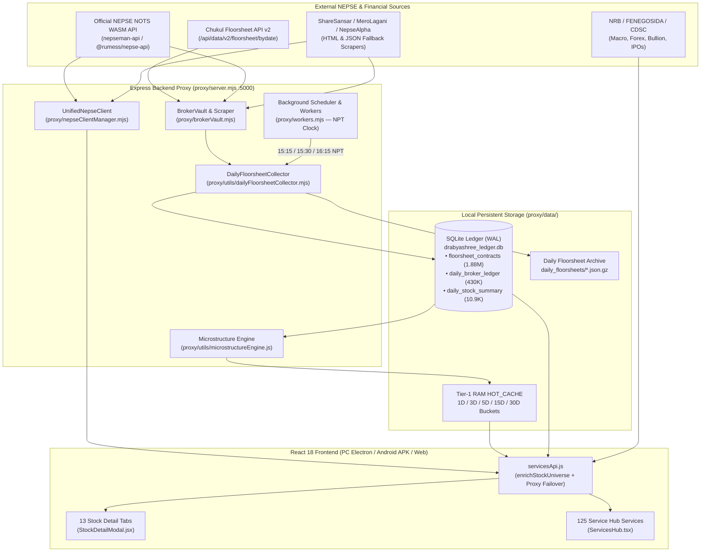

# DRABYASHREE NEPSE — PHASE 0: COMPLETE PROJECT ARCHITECTURE & DISCOVERY AUDIT

**Audit Date:** 2026-10-30  
**Project Root:** `c:\Users\Hp\Desktop\Software\nepse app`  
**Audit Phase:** PHASE 0 — Safety & Project Discovery (Read-Only)  
**Auditor Role:** Senior Software Auditor, Backend Engineer, Database Engineer, NEPSE Market Data Engineer & Financial Data Quality Analyst  

---

## 1. COMPLETE PROJECT STRUCTURE

```text
c:\Users\Hp\Desktop\Software\nepse app\
├── .env.example                          # Environment variable template (Firebase, Proxy URL)
├── package.json                          # Dependencies, scripts, and Electron builder config
├── vite.config.js                        # Vite 5 frontend build & dev server config
├── capacitor.config.json                 # Capacitor 6 Android mobile packaging config
├── render.yaml                           # Render.com cloud deployment blueprint
├── electron-main.cjs                     # Electron desktop process entry point
├── android/                              # Native Android Gradle project (Capacitor)
├── migrations/                           # PostgreSQL schema migrations (001_initial_schema.sql)
│   └── 001_initial_schema.sql
├── src/                                  # React 18 Frontend (JSX + TypeScript)
│   ├── App.jsx                           # Root shell, navigation, live polling & global modals
│   ├── main.jsx                          # React DOM entry point
│   ├── components/                       # 85+ UI & analytical service components
│   │   ├── StockDetailModal.jsx          # Primary 13-Tab Stock Intelligence Modal
│   │   ├── StockInformationHubModal.tsx  # Secondary 14-Tab Telemetry Hub Modal
│   │   ├── ServicesHub.tsx               # 125-Service Hub Registry & UniversalScreener
│   │   ├── AccumulationDistributionRadar.jsx
│   │   ├── BrokerFlowDominanceService.tsx
│   │   ├── BrokerSmartFlowTracker.jsx
│   │   ├── BrokerAccumulationView.jsx
│   │   ├── FloorsheetServiceTab.tsx
│   │   ├── EntryExitAnalyzer.jsx
│   │   ├── Master100ProfitWorkstation.tsx
│   │   ├── MultibaggerHunterService.tsx
│   │   ├── MinerviniLeaderboard.tsx
│   │   ├── NepseAgentDashboard.tsx
│   │   ├── AlgorithmicSignalTrackRecord.tsx
│   │   └── ... (70+ specialized analytical components)
│   ├── context/                          # React Context providers (Auth, Theme, Market, Portfolio)
│   ├── hooks/                            # Custom React hooks (useBackHandler, etc.)
│   ├── services/                         # Frontend domain services (api, notifications, etc.)
│   ├── types/                            # TypeScript interfaces
│   └── utils/                            # Shared quantitative, calendar, and API utilities
│       ├── nepseCalendar.js              # Authoritative NEPSE trading calendar & NPT clock
│       ├── servicesApi.js                # Unified frontend API client & data normalization
│       ├── indicators.js                 # Technical indicators (RSI, MACD, EMA, SMA, BB, ATR)
│       ├── stockmap.json                 # Static metadata map of NEPSE scrips & sectors
│       └── ...
├── proxy/                                # Express.js Backend & Quantitative Telemetry Engine
│   ├── server.mjs                        # Main HTTP server (Port 5000) & 110+ API endpoints
│   ├── nepseClientManager.mjs            # Dual-WASM NEPSE API client (nepseman-api + @rumess/nepse-api)
│   ├── brokerVault.mjs                   # Floorsheet scraper, disk cache & broker aggregation engine
│   ├── workers.mjs                       # Background schedulers, Telegram bot & daily jobs
│   ├── aiEngine.mjs                      # Multi-LLM AI Guru analysis router
│   ├── newsEngine.mjs                    # Financial news & announcement scraper
│   ├── ipoEngine.mjs                     # IPO/FPO/Right Share pipeline scraper
│   ├── predictorEngine.mjs               # Quantitative price & trend prediction engine
│   ├── nrbEngine.mjs                     # NRB macroeconomic & banking indicator service
│   ├── bullionEngine.mjs                 # Gold/Silver federation rate scraper
│   ├── syncRouter.mjs                    # Cross-device user portfolio/watchlist/journal sync
│   ├── db.mjs                            # Optional PostgreSQL connection pool (`pg`)
│   ├── db/
│   │   ├── ledgerStore.js                # Primary SQLite (`better-sqlite3`) analytical store & HOT_CACHE
│   │   └── signalTrackerStore.js         # Algorithmic signal tracking & audit store
│   ├── routes/
│   │   ├── radarRoutes.js                # `/api/radar/*` & `/api/ledger/*` endpoints
│   │   ├── stockTelemetryRoutes.mjs      # `/api/stocks/:symbol/telemetry` & `/api/market/macro-shield`
│   │   ├── floorsheetHubRoutes.mjs       # `/api/floorsheet/hub` tick-level contract engine
│   │   ├── aiGuruRoutes.mjs              # `/api/ai-guru/:symbol` quantitative trade plan engine
│   │   └── signalTrackRecordRoutes.mjs   # `/api/signals/track-record-enriched`
│   ├── utils/
│   │   ├── dailyFloorsheetCollector.mjs  # Daily post-market floorsheet downloader & SQLite ingester
│   │   ├── microstructureEngine.js       # Multi-day Wyckoff, Chaikin, BCR & whale diagnostics
│   │   └── sharedBrokerAggregationEngine.js
│   └── data/                             # Local persistent data vaults
│       ├── drabyashree_ledger.db         # Active SQLite database (WAL mode)
│       ├── drabyashree_ledger.db.gz      # Compressed bootstrap seed snapshot
│       ├── daily_floorsheets/            # Raw daily `.json` and `.json.gz` floorsheet archives
│       ├── broker_cache/                 # Cached broker summary snapshots
│       └── last_known_market.json        # Persistent live market snapshot fallback
├── scripts/                              # 50+ maintenance, backfill, audit & build scripts
└── tests/                                # Automated verification & stress test suites
```

---

## 2. STACK, INFRASTRUCTURE, DATABASES & DEPLOYMENT ENVIRONMENT

| Layer | Technology / Library | File Reference | Purpose |
| :--- | :--- | :--- | :--- |
| **Frontend Framework** | React 18.3.1 + Vite 5.3.1 (JSX & TypeScript) | [`package.json`](file:///c:/Users/Hp/Desktop/Software/nepse%20app/package.json) | Single-page analytical workstation UI |
| **Styling & Charts** | Tailwind CSS 3.4 + Lucide React + `lightweight-charts` 5.1 | [`package.json`](file:///c:/Users/Hp/Desktop/Software/nepse%20app/package.json) | Financial charting and responsive dark-mode UI |
| **Desktop App** | Electron 33.4 + `electron-builder` 25.1 | [`electron-main.cjs`](file:///c:/Users/Hp/Desktop/Software/nepse%20app/electron-main.cjs) | Windows desktop `.exe` (NSIS installer) |
| **Mobile App** | Capacitor 6.2 (`@capacitor/android`) | [`capacitor.config.json`](file:///c:/Users/Hp/Desktop/Software/nepse%20app/capacitor.config.json) | Android `.apk` packaging (`com.drabyashree.nepse`) |
| **Backend Framework** | Node.js (ESM) + Express 4.19.2 | [`proxy/server.mjs`](file:///c:/Users/Hp/Desktop/Software/nepse%20app/proxy/server.mjs) | REST API proxy, scraper, and quantitative engine on Port `5000` |
| **Primary Analytical DB** | SQLite 3 (`better-sqlite3` v12.8.0, WAL mode) | [`proxy/db/ledgerStore.js`](file:///c:/Users/Hp/Desktop/Software/nepse%20app/proxy/db/ledgerStore.js) | Local zero-latency store at `proxy/data/drabyashree_ledger.db` |
| **In-Memory Tier-1 Cache** | `HOT_CACHE` (`Map` + precomputed timeframe buckets) & `NodeCache` | [`proxy/db/ledgerStore.js`](file:///c:/Users/Hp/Desktop/Software/nepse%20app/proxy/db/ledgerStore.js) | Sub-millisecond serving of `1D`, `3D`, `5D`, `15D`, `30D` radar & diagnostics |
| **Optional Cloud DB** | PostgreSQL (`pg` v8.20.0) | [`proxy/db.mjs`](file:///c:/Users/Hp/Desktop/Software/nepse%20app/proxy/db.mjs) | Optional cloud relational store (disabled when `DATABASE_URL` is unset) |
| **Cloud Auth & Sync** | Firebase Client SDK + `firebase-admin` | [`proxy/syncRouter.mjs`](file:///c:/Users/Hp/Desktop/Software/nepse%20app/proxy/syncRouter.mjs) | User authentication & cross-device sync (`drabyashree-nepse-hub-11ef9`) |
| **External Market APIs** | `nepseman-api` (Primary WASM), `@rumess/nepse-api` (Secondary WASM), Chukul, ShareSansar, MeroLagani, NepseAlpha | [`proxy/nepseClientManager.mjs`](file:///c:/Users/Hp/Desktop/Software/nepse%20app/proxy/nepseClientManager.mjs), [`proxy/brokerVault.mjs`](file:///c:/Users/Hp/Desktop/Software/nepse%20app/proxy/brokerVault.mjs) | Live market quotes, indices, depth, historical candles, and floorsheets |
| **Cloud Hosting** | Render.com (`render.yaml`) | [`render.yaml`](file:///c:/Users/Hp/Desktop/Software/nepse%20app/render.yaml) | Hosted remote proxy fallback for mobile APK & web clients |

---

## 3. DATA COLLECTION MODULES & SCHEDULERS

### 3.1 Core Data Collection Modules
1. **[`proxy/nepseClientManager.mjs`](file:///c:/Users/Hp/Desktop/Software/nepse%20app/proxy/nepseClientManager.mjs) (`UnifiedNepseClient`):**
   - Dual-engine WASM authentication against official NEPSE NOTS endpoints (`nepseman-api` primary, `@rumess/nepse-api` fallback).
   - Disables strict TLS verification (`NODE_TLS_REJECT_UNAUTHORIZED = "0"`) to handle NEPSE's incomplete SSL certificate chain.
   - Multi-source fallback chain to ShareSansar and MeroLagani HTML scrapers when official NEPSE endpoints are unreachable or rate-limited.
   - Persists last verified snapshot to `proxy/data/last_known_market.json`.

2. **[`proxy/brokerVault.mjs`](file:///c:/Users/Hp/Desktop/Software/nepse%20app/proxy/brokerVault.mjs):**
   - Retrieves full-session floorsheets and per-scrip/per-broker aggregations.
   - Multi-tier source cascade:
     1. Local SQLite ledger (`daily_broker_ledger` / `floorsheet_contracts`).
     2. Local disk archive (`proxy/data/daily_floorsheets/floorsheet-YYYY-MM-DD.json` / `.gz` and `proxy/data/floorsheets/`).
     3. Chukul API (`https://chukul.com/api/data/v2/floorsheet/bydate/?date=YYYY-MM-DD&page=N&size=500`).
     4. Official NEPSE NOTS POST `/nepse-data/floorsheet` (paginated 500 records/page).
     5. ShareSansar / MeroLagani HTML table fallbacks.

3. **[`proxy/utils/dailyFloorsheetCollector.mjs`](file:///c:/Users/Hp/Desktop/Software/nepse%20app/proxy/utils/dailyFloorsheetCollector.mjs):**
   - `downloadAndArchiveDailyFloorsheet(dateStr, options)`: Downloads the full session floorsheet, checks for date mislabeling against embedded `businessDate`, writes both `.json` and `.json.gz` into `proxy/data/daily_floorsheets/`, updates `archive_index.json`, and calls `ingestContractsToLedger(targetDate, trades)`.
   - `ingestContractsToLedger(tradeDate, trades)`: Atomically inserts tick-level rows into `floorsheet_contracts`, per-broker daily rollups into `daily_broker_ledger`, and per-scrip OHLCV rollups into `daily_stock_summary`.

4. **[`proxy/db/ledgerStore.js`](file:///c:/Users/Hp/Desktop/Software/nepse%20app/proxy/db/ledgerStore.js):**
   - Manages the SQLite database (`drabyashree_ledger.db`), automatic bootstrap from `drabyashree_ledger.db.gz`, historical backfill (`backfillRealHistoricalFloorsheets`), calendar quarantine sanitization (`sanitizeHolidayContaminatedRows`), and `rebuildHotCache()`.

### 3.2 Background Workers & Schedulers ([`proxy/workers.mjs`](file:///c:/Users/Hp/Desktop/Software/nepse%20app/proxy/workers.mjs) & [`proxy/server.mjs`](file:///c:/Users/Hp/Desktop/Software/nepse%20app/proxy/server.mjs))
1. **Master Minute Scheduler (`checkSchedules` in [`proxy/workers.mjs`](file:///c:/Users/Hp/Desktop/Software/nepse%20app/proxy/workers.mjs#L569-L660)):**
   - Runs via `setInterval(checkSchedules, 60 * 1000)` using Nepal Standard Time (`UTC + 05:45`).
   - Checks `isNepseTradingDay(now)` from [`src/utils/nepseCalendar.js`](file:///c:/Users/Hp/Desktop/Software/nepse%20app/src/utils/nepseCalendar.js):
     - `09:30 NPT`: Pre-Market Morning Intelligence Briefing (Telegram).
     - `10:48 NPT`: Pre-Open Gate Order-Book Imbalance Scan (Telegram).
     - `11:00–14:59 NPT` (every 15 mins): Live Intraday Anomaly & Volume Surge Scan (`runLiveIntradayScan`).
     - `15:05 NPT`: Post-Market Wrap & Top Gainers/Losers Dispatch (`runPostMarketCloseWrap`).
     - `15:15 NPT`: **Automated Daily Floorsheet Archive & SQLite Ledger Ingestion** (`downloadAndArchiveDailyFloorsheet(todayStr)` + `rebuildHotCache()`).
     - `15:30 NPT` & `16:15 NPT`: **Retry Windows** if the `15:15 NPT` collection failed or returned 0 trades.
2. **Startup Catch-Up Check ([`proxy/workers.mjs`](file:///c:/Users/Hp/Desktop/Software/nepse%20app/proxy/workers.mjs#L672-L686)):**
   - 15 seconds after server boot, if current NPT time is `>= 15:15` on a trading day, automatically triggers `downloadAndArchiveDailyFloorsheet(todayStr)` and `rebuildHotCache()`.
3. **Server Startup Ledger Sync ([`proxy/server.mjs`](file:///c:/Users/Hp/Desktop/Software/nepse%20app/proxy/server.mjs)):**
   - On Express startup, seeds from disk/snapshot if empty, runs `rebuildHotCache()`, and triggers background historical backfill if fewer than 30 trading days exist.

---

## 4. FLOORSHEET API ENDPOINTS & DATABASE TABLES

### 4.1 SQLite Database Schema & Live Row Inventory (`proxy/data/drabyashree_ledger.db`)

| Table / View Name | Type | Live Row Count | Primary Key / Unique Constraint | Purpose |
| :--- | :--- | ---: | :--- | :--- |
| `floorsheet_contracts` | Table | **1,886,935** | `contract_no TEXT PRIMARY KEY` | Tick-by-tick floorsheet contracts (`symbol`, `trade_date`, `trade_time`, `buyer_broker`, `seller_broker`, `kitta`, `rate`, `amount`, `aggressor_side`, `is_internal_cross`, `is_whale_print`) |
| `daily_broker_ledger` | Table | **430,857** | `PRIMARY KEY (trade_date, symbol, broker_id)` | Daily per-stock per-broker aggregated buy/sell volume, amount, and cross volume |
| `daily_stock_summary` | Table | **10,908** | `PRIMARY KEY (trade_date, symbol)` | Daily per-stock OHLCV, total turnover, trades, and quarantine status (38 distinct trading dates) |
| `scrip_fundamentals` | Table | **392** | `symbol TEXT PRIMARY KEY` | EPS, P/E, Book Value, PBV, ROE, Paid-up Capital, Promoter/Public Float % |
| `algorithmic_signal_ledger` | Table | **70** | `id TEXT PRIMARY KEY` | Algorithmic entry signals, entry VWAP, stop-loss, targets, MFE/MAE, status |
| `scrip_corporate_actions` | Table | **37** | `symbol TEXT PRIMARY KEY` | Bonus share %, cash dividend %, book closure dates |
| `official_exchange_benchmarks` | Table | **36** | `trade_date TEXT PRIMARY KEY` | Daily NEPSE index & benchmark close values |
| `daily_ingestion_log` | Table | **5** | `trade_date TEXT PRIMARY KEY` | Audit log of daily floorsheet ingestion status |
| `market_depth_cache` | Table | **0** | `symbol TEXT PRIMARY KEY` | Order book depth cache |
| `floorsheet_broker_summary` | View | *(Virtual)* | View over `daily_broker_ledger` | Maps `daily_broker_ledger` columns to `broker_no`, `buy_kitta`, `sell_kitta`, `vwap` |
| `v_scrip_volume_profile_5d` | View | *(Virtual)* | View over `daily_stock_summary` | 5-day rolling volume profile view |
| `signal_ledger` | View | *(Virtual)* | View over `algorithmic_signal_ledger` | Normalized view for signal track record routes |

### 4.2 Floorsheet, Broker & Ledger API Endpoints

| HTTP Method & Route | Handler File | Description |
| :--- | :--- | :--- |
| `GET /api/floorsheet/hub` | [`proxy/routes/floorsheetHubRoutes.mjs`](file:///c:/Users/Hp/Desktop/Software/nepse%20app/proxy/routes/floorsheetHubRoutes.mjs#L102) | Tick-level contract search with date, symbol, buyer, seller, minKitta, whaleOnly, excludeCross filters |
| `GET /api/floorsheet/daily-archive` | [`proxy/server.mjs`](file:///c:/Users/Hp/Desktop/Software/nepse%20app/proxy/server.mjs) | Lists locally archived daily floorsheet files (`archive_index.json`) |
| `POST /api/floorsheet/daily-archive/download` | [`proxy/server.mjs`](file:///c:/Users/Hp/Desktop/Software/nepse%20app/proxy/server.mjs) | Triggers on-demand download & SQLite ingestion for a target `date` |
| `GET /api/floorsheet/daily-archive/:date` | [`proxy/server.mjs`](file:///c:/Users/Hp/Desktop/Software/nepse%20app/proxy/server.mjs) | Retrieves raw floorsheet contracts for `:date` |
| `GET /api/floorsheet/:symbol` | [`proxy/server.mjs`](file:///c:/Users/Hp/Desktop/Software/nepse%20app/proxy/server.mjs) | Per-stock floorsheet transactions + broker concentration summary |
| `GET /api/broker-analysis/:symbol` | [`proxy/server.mjs`](file:///c:/Users/Hp/Desktop/Software/nepse%20app/proxy/server.mjs) | Per-stock broker accumulation/distribution analysis (`days=1..30` or `days=all`, `date=YYYY-MM-DD`) |
| `GET /api/broker-summary-all` | [`proxy/server.mjs`](file:///c:/Users/Hp/Desktop/Software/nepse%20app/proxy/server.mjs) | Market-wide per-stock top accumulator/distributor summary (`days`, `date`) |
| `GET /api/smart-money/broker-dominance` | [`proxy/server.mjs`](file:///c:/Users/Hp/Desktop/Software/nepse%20app/proxy/server.mjs) | Market-wide broker dominance, top 10 stocks per broker, matching buy/sell |
| `GET /api/smart-money/broker-holdings/:brokerId` | [`proxy/server.mjs`](file:///c:/Users/Hp/Desktop/Software/nepse%20app/proxy/server.mjs) | All-time cumulative net stock holdings for a specific broker (`getBrokerAllTimeTopHoldings`) |
| `GET /api/radar` & `/api/radar/accumulation-distribution` | [`proxy/routes/radarRoutes.js`](file:///c:/Users/Hp/Desktop/Software/nepse%20app/proxy/routes/radarRoutes.js#L105) | Multi-timeframe (`1D`, `3D`, `5D`, `15D`, `30D`) Wyckoff/Chaikin accumulation radar |
| `GET /api/radar/broker-tracker` | [`proxy/routes/radarRoutes.js`](file:///c:/Users/Hp/Desktop/Software/nepse%20app/proxy/routes/radarRoutes.js#L244) | Multi-criteria smart-money broker accumulation & dumping tracker |
| `GET /api/radar/whale-archive` | [`proxy/routes/radarRoutes.js`](file:///c:/Users/Hp/Desktop/Software/nepse%20app/proxy/routes/radarRoutes.js) | Date-by-date top 5 institutional whale accumulation archive |
| `GET /api/radar/:symbol` | [`proxy/routes/radarRoutes.js`](file:///c:/Users/Hp/Desktop/Software/nepse%20app/proxy/routes/radarRoutes.js) | Deep microstructure diagnostic for a single stock (`1D`, `5D`, `15D`, `30D`, or `date`) |
| `GET /api/ledger/dates` | [`proxy/routes/radarRoutes.js`](file:///c:/Users/Hp/Desktop/Software/nepse%20app/proxy/routes/radarRoutes.js) | Returns all valid NEPSE trading dates stored in `drabyashree_ledger.db` |
| `GET /api/ledger/status` | [`proxy/routes/radarRoutes.js`](file:///c:/Users/Hp/Desktop/Software/nepse%20app/proxy/routes/radarRoutes.js) | Ledger row counts, date range, and backfill status |
| `GET /api/stocks/:symbol/telemetry` | [`proxy/routes/stockTelemetryRoutes.mjs`](file:///c:/Users/Hp/Desktop/Software/nepse%20app/proxy/routes/stockTelemetryRoutes.mjs#L35) | Unified stock telemetry (quote, 60D candles, 30D broker rollup, all-time holdings, AI trade plan) |

---

## 5. COMPLETE INVENTORY OF THE 13 STOCK TABS

The 13 stock tabs are defined in [`src/components/StockDetailModal.jsx`](file:///c:/Users/Hp/Desktop/Software/nepse%20app/src/components/StockDetailModal.jsx#L2800-L2896) inside `allTabs`:

| # | Tab ID | Tab Label | Category | Primary Component / View | Primary API Endpoints / Data Sources |
| :-: | :--- | :--- | :--- | :--- | :--- |
| **1** | `overview` | **Overview** | `trading` | Inline Overview Dashboard + [`Stock360OverviewTab`](file:///c:/Users/Hp/Desktop/Software/nepse%20app/src/components/StockDetailModal.jsx) | `/api/company/:symbol`, `/api/stocks/:symbol/telemetry`, `/api/price-history/:symbol`, `/api/broker-analysis/:symbol` |
| **2** | `technicals` | **Technicals** | `trading` | Technical Speedometer, Oscillators, Moving Averages & S/R Matrix | `/api/price-history/:symbol` + [`src/utils/indicators.js`](file:///c:/Users/Hp/Desktop/Software/nepse%20app/src/utils/indicators.js) (`computeAllIndicators`) |
| **3** | `broker_analysis` | **Broker Flow** | `trading` | Institutional Broker Flow, Accumulation/Distribution & Concentration | `/api/broker-analysis/:symbol?days=...&date=...`, `/api/radar/:symbol`, `/api/stocks/:symbol/telemetry` |
| **4** | `market_depth` | **Market Depth** | `trading` | 5-Level Buy/Sell Order Book & Order Book Imbalance Ratio (OBIR) | `/api/market-depth/:symbol` |
| **5** | `floorsheet` | **Floorsheet** | `trading` | Live & Historical Tick-by-Tick Floorsheet Tape & Block Deals | `/api/floorsheet/:symbol`, `/api/floorsheet/hub?symbol=:symbol&date=...` |
| **6** | `volume_profile` | **Volume Profile (POC)** | `trading` | Point of Control (POC), Value Area High/Low (VAH/VAL) & Price-Volume Histogram | `/api/floorsheet/:symbol`, `/api/stocks/:symbol/telemetry`, `/api/price-history/:symbol` |
| **7** | `history` | **Price History** | `trading` | Interactive OHLCV Candlestick Chart & Historical Daily Price Table | `/api/price-history/:symbol` (`daily_stock_summary` + NEPSE/ShareSansar history) |
| **8** | `fundamentals` | **Fundamentals** | `financials` | EPS, P/E, BVPS, PBV, ROE, Graham Number, Paid-up Capital & Lock-in Schedule | `/api/fundamentals/:symbol`, `/api/company/:symbol` (`scrip_fundamentals`) |
| **9** | `dividends` | **Dividends & Rights** | `financials` | Historical Bonus Shares, Cash Dividends, Right Shares & Book Closure Dates | `/api/dividends/:symbol`, [`DividendHistoryPanel.tsx`](file:///c:/Users/Hp/Desktop/Software/nepse%20app/src/components/DividendHistoryPanel.tsx) (`scrip_corporate_actions`) |
| **10** | `reports` | **Reports & News** | `financials` | Company Financial Announcements, Quarterly Reports & Scrip News | `/api/news?symbol=:symbol`, `/api/company-news/:symbol` |
| **11** | `compare` | **Compare Peers** | `financials` | Side-by-Side Sector Peer Valuation & Performance Matrix | [`CompareStocks.jsx`](file:///c:/Users/Hp/Desktop/Software/nepse%20app/src/components/CompareStocks.jsx) + `stocks` universe + `/api/fundamentals/:symbol` |
| **12** | `seasonality` | **Seasonality** | `tools` | 10-Year Monthly Hit-Rate & Seasonal Return Heatmap for Symbol | [`SeasonalityAnalyticsService.jsx`](file:///c:/Users/Hp/Desktop/Software/nepse%20app/src/components/SeasonalityAnalyticsService.jsx) + `/api/price-history/:symbol` |
| **13** | `ai_calc` | **AI Guru & Tools** | `tools` | Quantitative AI Trade Plan (Entry, Stop, Targets) + Quick WACC/Profit Calculators | `/api/ai-guru/:symbol`, `/api/predict/:symbol`, `/api/ai-analysis/:symbol` |

*(Note: A secondary modal [`src/components/StockInformationHubModal.tsx`](file:///c:/Users/Hp/Desktop/Software/nepse%20app/src/components/StockInformationHubModal.tsx) also provides a 14-tab Telemetry Hub view with `OVERVIEW`, `STOCK_SCORE`, `TECHNICALS`, `BROKER_FLOW`, `MARKET_DEPTH`, `FLOORSHEET`, `VOLUME_PROFILE`, `FUNDAMENTALS_LOCKIN`, `DIVIDENDS_RIGHTS`, `REPORTS_ANNOUNCEMENTS`, `COMPARE_PEERS`, `PRICE_HISTORY_CHARTS`, `SEASONALITY`, and `AI_GURU_TOOLS`.)*

---

## 6. COMPLETE INVENTORY OF ALL 125 SERVICE HUB SERVICES

All **125** services are registered in `ALL_SERVICES` in [`src/components/ServicesHub.tsx`](file:///c:/Users/Hp/Desktop/Software/nepse%20app/src/components/ServicesHub.tsx#L188-L329) across 8 categories:

### Category 1: Flagship Analytical Suites (20 Services — `cat: 'flagship'`)
| # | Service ID | Service Name | Mapped Component | Data Source / Calculation Method |
| :-: | :--- | :--- | :--- | :--- |
| 1 | `master-100-profit` | 👑 Master Guide: 100% Profit Engine | [`Master100ProfitWorkstation`](file:///c:/Users/Hp/Desktop/Software/nepse%20app/src/components/Master100ProfitWorkstation.tsx) | Multi-gate composite of Smart Money flow, technical breakout, and fundamentals |
| 2 | `multibagger-hunter` | 🎯 100% Hunter — 8-Gate Multibagger Screener | [`MultibaggerHunterService`](file:///c:/Users/Hp/Desktop/Software/nepse%20app/src/components/MultibaggerHunterService.tsx) | 8-gate quantitative filter (float, accumulation, ROE, stage 2 trend) |
| 3 | `minervini-leaderboard` | 🏆 Minervini Stage 2 Leader Board + OAMI | [`MinerviniLeaderboard`](file:///c:/Users/Hp/Desktop/Software/nepse%20app/src/components/MinerviniLeaderboard.tsx) | Mark Minervini SEPA Trend Template + OAMI institutional overlay |
| 4 | `daily-prime-pick` | Daily Prime Breakout & Buy-Zone Pick | [`PrimePickService`](file:///c:/Users/Hp/Desktop/Software/nepse%20app/src/components/PrimePickService.jsx) | Daily high-conviction breakout & buy-zone scoring engine |
| 5 | `short-term-profit-plan` | 1–2W Short-Term Profit Plan | [`ShortTermProfitPlan`](file:///c:/Users/Hp/Desktop/Software/nepse%20app/src/components/ShortTermProfitPlan.tsx) | 1–2 week swing trade setup generator with T+2 settlement awareness |
| 6 | `entry-exit-analyzer` | Entry/Exit Analyzer & Target Matrix | [`EntryExitAnalyzer`](file:///c:/Users/Hp/Desktop/Software/nepse%20app/src/components/EntryExitAnalyzer.jsx) | ATR/Support/Resistance entry zone, stop-loss, R1/R2/R3 target matrix |
| 7 | `stock-momentum` | Multi-Timeframe Momentum Analyzer | [`StockMomentumAnalyzer`](file:///c:/Users/Hp/Desktop/Software/nepse%20app/src/components/StockMomentumAnalyzer.jsx) | Multi-timeframe return velocity, RSI, and volume momentum |
| 8 | `stealth-accumulation-tracker` | Accumulation & Distribution Radar | [`AccumulationDistributionRadar`](file:///c:/Users/Hp/Desktop/Software/nepse%20app/src/components/AccumulationDistributionRadar.jsx) | `/api/radar` (`1D`, `5D`, `15D`, `30D`) Wyckoff, Chaikin, BCR3/BCR5 & whale phases |
| 9 | `graham-intrinsic` | Graham Intrinsic Value Calculator | [`GrahamValuation`](file:///c:/Users/Hp/Desktop/Software/nepse%20app/src/components/GrahamValuation.jsx) | Benjamin Graham $\sqrt{22.5 \times \text{EPS} \times \text{BVPS}}$ valuation vs LTP |
| 10 | `gdp-vs-nepse` | GDP vs NEPSE (Buffett Indicator) | [`GdpVsNepseMacroService`](file:///c:/Users/Hp/Desktop/Software/nepse%20app/src/components/GdpVsNepseMacroService.tsx) | Total NEPSE Market Cap to Nepal GDP ratio historical valuation bands |
| 11 | `decision-probability` | Decision Probability Index (DPI 0–100) | `UniversalScreener` (`dpi >= 50`) | Composite `dpi` (0–100) score from `enrichStockUniverse` |
| 12 | `seasonality` | NEPSE 10-Year Seasonality Analytics | [`SeasonalityAnalyticsService`](file:///c:/Users/Hp/Desktop/Software/nepse%20app/src/components/SeasonalityAnalyticsService.jsx) | Historical monthly/quarterly NEPSE & sector seasonality |
| 13 | `strategy-lab` | Strategy Lab Backtesting Engine | [`StrategyLabService`](file:///c:/Users/Hp/Desktop/Software/nepse%20app/src/components/StrategyLabService.jsx) | Rule-based strategy simulation over historical candles |
| 14 | `backtest-report` | Backtest Engine & Walk-Forward Report | [`BacktestReportScreen`](file:///c:/Users/Hp/Desktop/Software/nepse%20app/src/components/BacktestReportScreen.jsx) | Walk-forward backtest equity curve, Sharpe, and win-rate report |
| 15 | `paper-trading-journal` | Paper Trading Mode & Trade Journal | [`PaperTradingJournalScreen`](file:///c:/Users/Hp/Desktop/Software/nepse%20app/src/components/PaperTradingJournalScreen.jsx) | Simulated paper trading execution & P&L tracking |
| 16 | `stock-selection-screener` | Stock Selection Screener & Scoring | [`StockSelectionScreener`](file:///c:/Users/Hp/Desktop/Software/nepse%20app/src/components/StockSelectionScreener.jsx) | Multi-factor fundamental + technical + broker flow stock screener |
| 17 | `broker-accumulation-view` | Broker Accumulation & CR5 Telemetry | [`BrokerAccumulationView`](file:///c:/Users/Hp/Desktop/Software/nepse%20app/src/components/BrokerAccumulationView.jsx) | Per-scrip CR5 concentration ratio, net accumulation & broker VWAP |
| 18 | `watchlist-entry-alerts` | Watchlist Entry & Risk Alerts | [`WatchlistEntryAlertModal`](file:///c:/Users/Hp/Desktop/Software/nepse%20app/src/components/WatchlistEntryAlertModal.jsx) | Automated buy-zone and stop-loss alert monitor for watchlisted scrips |
| 19 | `ai-agent-dossier` | Autonomous AI Scrip Intelligence Agent | [`NepseAgentDashboard`](file:///c:/Users/Hp/Desktop/Software/nepse%20app/src/components/NepseAgentDashboard.tsx) | Deep multi-agent scrip dossier (`/api/ai-guru/:symbol` + telemetry) |
| 20 | `signals-track-record` | Algorithmic Signal Track Record & Audit | [`AlgorithmicSignalTrackRecord`](file:///c:/Users/Hp/Desktop/Software/nepse%20app/src/components/AlgorithmicSignalTrackRecord.tsx) | `/api/signals/track-record-enriched` audited win-rate, MFE/MAE & alpha |

### Category 2: Smart Money & Institutional Flow (10 Services — `cat: 'smart-money'`)
| # | Service ID | Service Name | Mapped Component | Data Source / Calculation Method |
| :-: | :--- | :--- | :--- | :--- |
| 21 | `broker-smart-flow` | ⚡ Broker Smart Flow & Early Ignition Workstation | [`BrokerSmartFlowTracker`](file:///c:/Users/Hp/Desktop/Software/nepse%20app/src/components/BrokerSmartFlowTracker.jsx) | `/api/radar/broker-tracker` & `/api/radar` slow accumulation, dumping & capital rotation |
| 22 | `whale-daily-archive` | Daily Top 5 Whale Archive (दैनिक ह्वेल) | [`AccumulationDistributionRadar`](file:///c:/Users/Hp/Desktop/Software/nepse%20app/src/components/AccumulationDistributionRadar.jsx) (`initialTab="archive"`) | `/api/radar/whale-archive` daily top 5 institutional whale accumulation records |
| 23 | `unusual-trades` | Top Unusual Block Deals (≥ 1 Cr) | `UniversalScreener` (`turnover > 1e7`) | High-turnover scrips with average ticket size calculation |
| 24 | `players-choices` | Smart Money / Big Players Choices | `UniversalScreener` (`turnover > 5e6 && nbar >= 1.05`) | High-turnover stocks with positive net broker accumulation (`bcr3BuyPct`) |
| 25 | `broker-analysis` | Broker A/D Flow Analysis | [`BrokerAnalysisService`](file:///c:/Users/Hp/Desktop/Software/nepse%20app/src/components/BrokerAnalysisService.jsx) | `/api/broker-analysis/:symbol` per-stock buyer/seller accumulation breakdown |
| 26 | `broker-dominance` | Broker Dominance & Cornering (BCR3) | [`BrokerFlowDominanceService`](file:///c:/Users/Hp/Desktop/Software/nepse%20app/src/components/BrokerFlowDominanceService.tsx) (`mode="dominance"`) | `/api/smart-money/broker-dominance` + `/api/broker-summary-all` BCR3 cornering |
| 27 | `broker-top10` | Broker Top 10 Stocks (Brokers 58, 45, 34) | [`BrokerFlowDominanceService`](file:///c:/Users/Hp/Desktop/Software/nepse%20app/src/components/BrokerFlowDominanceService.tsx) (`mode="top10"`) | Per-broker top 10 net bought, top 10 traded, and all-time net holdings |
| 28 | `broker-heatmap` | Broker Network Heatmap | [`BrokerHeatmapService`](file:///c:/Users/Hp/Desktop/Software/nepse%20app/src/components/BrokerHeatmapService.jsx) | Visual treemap/heatmap of broker buying vs selling across sectors |
| 29 | `broker-favourites` | Broker Historical Favourites | [`BrokerFavouritesService`](file:///c:/Users/Hp/Desktop/Software/nepse%20app/src/components/BrokerFavouritesService.jsx) | Multi-day recurring favourite stocks of major brokers |
| 30 | `broker-flow` | Institutional Broker Flow Telemetry | [`BrokerFlowDominanceService`](file:///c:/Users/Hp/Desktop/Software/nepse%20app/src/components/BrokerFlowDominanceService.tsx) (`mode="flow"`) | 6-mode workstation (Flow, Dominance, Top 10, Matching, Daily Top Kitta, All-Time Retention) |

### Category 3: Trading & Technical Setups (36 Services — `cat: 'trading'`)
| # | Service ID | Service Name | Mapped Component | Data Source / Calculation Method |
| :-: | :--- | :--- | :--- | :--- |
| 31 | `candlestick-patterns` | 28 Candlestick Patterns Scanner | [`CandlestickPatternScannerService`](file:///c:/Users/Hp/Desktop/Software/nepse%20app/src/components/CandlestickPatternScannerService.tsx) | Scans OHLCV candles for 28 bullish/bearish candlestick formations |
| 32 | `technical-ratings` | Technical Speedometer (12 Indicators) | [`TechnicalRatingsGaugeService`](file:///c:/Users/Hp/Desktop/Software/nepse%20app/src/components/TechnicalRatingsGaugeService.tsx) | TradingView-style 12-indicator oscillator + MA speedometer gauge |
| 33 | `breakout-stocks` | Breakout & Trap Radar | [`BreakoutTrapRadar`](file:///c:/Users/Hp/Desktop/Software/nepse%20app/src/components/BreakoutTrapRadar.jsx) | Detects genuine volume breakouts vs institutional bull traps |
| 34 | `next-breakouts` | Coiling Under Resistance (Pre-Breakout) | `UniversalScreener` | `pChange > 0 && pChange < 3 && volumeSurgeRatio > 1.2` |
| 35 | `breakout-tradable` | Real-Time Breakout Scanner | `UniversalScreener` | `s.isBreakout` sorted by `pChange` |
| 36 | `trendline-breakout` | Trendline Breakout with Volume | `UniversalScreener` | `s.isBreakout` |
| 37 | `consolidating-stocks` | Consolidating & Coiling Base | `UniversalScreener` | `Math.abs(s.pChange) < 1 && s.volume > 5000` |
| 38 | `consolidating-picks` | Ultra-Tight Volatility Contraction Picks | `UniversalScreener` | `Math.abs(s.pChange) < 0.5` |
| 39 | `circuit-setup` | Circuit Setup Radar (±15% Daily Limit) | `UniversalScreener` | `Math.abs(s.pChange) >= 12` |
| 40 | `volume-shockers` | Volume Shockers & Z-Score Anomaly | `UniversalScreener` | `s.isVolumeShocker` sorted by `volumeZScore` |
| 41 | `relative-strength` | Relative Strength (Alpha vs NEPSE) | `UniversalScreener` | Sorted by `rsSpread` (stock % change minus NEPSE index % change) |
| 42 | `fresh-indicators` | Fresh RSI / MACD Inflection Signals | `UniversalScreener` | `(s.rsi < 35 \|\| s.rsi > 65) && s.pChange > 0` |
| 43 | `support-resistance` | 52W Support & Resistance Radar | `UniversalScreener` | `s.high52w && s.low52w` with distance from 52W High |
| 44 | `support-setups` | Basing Near Support (Swing Setups) | `UniversalScreener` | `s.pChange > -1 && s.pChange < 2` |
| 45 | `magnetic-support` | Drabyashree Magnetic Support Anchors | `UniversalScreener` | `lowDist <= 8%` or `RSI 30–45` without churn distribution |
| 46 | `breakable-resistance` | Drabyashree Breakable Resistance Radar | `UniversalScreener` | Within 6% of 52W High with `volumeSurgeRatio >= 1.2` |
| 47 | `breakdown-stocks` | Drabyashree Breakdown & Selloff Radar | `UniversalScreener` | `pChange <= -2.5` or `RSI < 35 && pChange < 0` |
| 48 | `volatile-stocks` | Drabyashree High Volatility & ATR Movers | `UniversalScreener` | Intraday range `((high - low) / ltp) * 100 >= 3.0%` |
| 49 | `hot-trending-stock` | Drabyashree Hot Trending Velocity Screener | `UniversalScreener` | `pChange >= 2.5 && (volumeSurgeRatio >= 1.2 \|\| turnover >= 5e6)` |
| 50 | `ai-momentum` | AI Momentum with Volume Confirmation | `UniversalScreener` | `pChange >= 2 && volumeSurgeRatio >= 1.3` |
| 51 | `hot-stocks` | Hot Stocks Today (Turnover + Surge) | `UniversalScreener` | `pChange > 3 && volumeSurgeRatio > 1.5` |
| 52 | `price-vs-volume` | Price Rise Confirmed by Volume (PVA) | `UniversalScreener` | `pChange > 0 && volumeSurgeRatio > 1.3` |
| 53 | `volume-spread` | Volume Spread Analysis (VSA Wyckoff) | `UniversalScreener` | Sorted by `volume * ((high - low) / ltp)` |
| 54 | `rsi-filter` | Full-Board Multi-Zone RSI Scanner | `UniversalScreener` | `s.rsi != null` sorted ascending by RSI |
| 55 | `macd-signal` | MACD Bullish Momentum Expansion | `UniversalScreener` | `s.macd && s.macd.histogram > 0` |
| 56 | `ema-scanner` | EMA-20 Short-Term Trend Confirmation | `UniversalScreener` | `s.ltp > s.ema20` |
| 57 | `ema-sma-scanner` | Golden Cross Scanner (EMA-20 > SMA-50) | `UniversalScreener` | `s.technicalScore > 60` *(See Bug #5 below)* |
| 58 | `bollinger-scanner` | Bollinger Bands Squeeze & Expansion | `UniversalScreener` | `s.volumeSurgeRatio > 1.5` *(See Bug #5 below)* |
| 59 | `volume-scanner` | Top 30 High-Volume Board | `UniversalScreener` | Top 30 sorted by `volume` |
| 60 | `pivot-points` | Classic Floor Pivot Points (R1/S1/P) | `UniversalScreener` | Displays `High` and `Low` *(See Bug #5 below)* |
| 61 | `fibonacci-levels` | Fibonacci Retracement & Extension Levels | [`FibonacciCalculatorService`](file:///c:/Users/Hp/Desktop/Software/nepse%20app/src/components/ServicesHub.tsx) | Interactive swing High/Low Fibonacci retracement & extension calculator |
| 62 | `dow-signals` | Dow Theory Trend Confirmation (HH/HL) | `UniversalScreener` | `pChange > 1 && technicalScore > 55` |
| 63 | `parallel-channel` | Regression & Parallel Channel Scanner | `UniversalScreener` | `Math.abs(pChange) < 3 && volume > 10000` |
| 64 | `trend-continuation` | Trend Continuation (Flags & Pennants) | `UniversalScreener` | `pChange > 0 && technicalScore > 60` |
| 65 | `strong-trend` | Strong Directional Trend Leaders | `UniversalScreener` | `Math.abs(pChange) > 3 && volume > 20000` |
| 66 | `advanced-charts` | Interactive TradingView Charting Engine | [`TradingViewChartService`](file:///c:/Users/Hp/Desktop/Software/nepse%20app/src/components/TradingViewChartService.jsx) | Multi-indicator interactive candlestick & volume charting suite |

### Category 4: Valuation & Fundamental Picks (16 Services — `cat: 'valuation'`)
| # | Service ID | Service Name | Mapped Component | Data Source / Calculation Method |
| :-: | :--- | :--- | :--- | :--- |
| 67 | `dividend-history` | Corporate Dividend Track Record | [`DividendHistoryPanel`](file:///c:/Users/Hp/Desktop/Software/nepse%20app/src/components/DividendHistoryPanel.tsx) | Historical bonus & cash dividend table across NEPSE companies |
| 68 | `dividend-kings` | Dividend Kings & High Yield Compounders | `UniversalScreener` | `eps >= 14 \|\| dividendYield > 3 \|\| bonusShare > 0` |
| 69 | `dividend-leaders` | Top Earnings Capacity Dividend Leaders | `UniversalScreener` | `eps >= 12 \|\| dividendYield > 0` |
| 70 | `fundamentals-pro` | Pro-Grade Fundamentals & Solvency Filter | `UniversalScreener` | `pe > 0 && pe <= 35 && (eps >= 12 \|\| bookValue >= 90)` |
| 71 | `fundamental-scanner` | Undervalued Fundamental Growth Scanner | `UniversalScreener` | `pe > 0 && pe <= 35 && (eps >= 10 \|\| bookValue >= 80)` |
| 72 | `pe-ranking` | P/E & PBV Sector Valuation Ranking | `UniversalScreener` | `pe > 0 && sector !== 'Mutual Funds'` sorted by lowest P/E |
| 73 | `lynch-garp` | Peter Lynch Growth-At-A-Reasonable-Price | `UniversalScreener` | `PEG <= 1.2 && pe <= 30 && eps > 10` |
| 74 | `equity-risk-premium` | Equity Risk Premium vs Bank FD (> 7.5%) | `UniversalScreener` | Earnings yield `(eps / ltp) * 100 > 8.0%` |
| 75 | `promoter-shares` | 🔒 Promoter Share Lock-in Expiry Countdown | [`PromoterSharesService`](file:///c:/Users/Hp/Desktop/Software/nepse%20app/src/components/PromoterSharesService.jsx) | Lock-in expiry dates, promoter shares unlocking & supply overhang risk |
| 76 | `mutual-funds-unlock` | Mutual Funds Portfolio & NAV Analysis | [`MutualFundsService`](file:///c:/Users/Hp/Desktop/Software/nepse%20app/src/components/MutualFundsService.jsx) | Mutual fund NAV discounts, maturity dates & institutional holdings |
| 77 | `float-analytics` | Public Float & Free-Float Turnover Analysis | `UniversalScreener` | Promoter %, Public Float %, and daily Float Turnover % |
| 78 | `stocks-by-market-cap` | Total Market Capitalization Ladder | `UniversalScreener` | Ranked by `marketCap` with Mega/Large/Mid/Small Cap tier classification |
| 79 | `stock-capitalization` | Tier-Based Capitalization Screener | `UniversalScreener` | Market cap ranking by sector |
| 80 | `stockwise-analysis` | Stock-by-Stock Fundamental Matrix | `UniversalScreener` | Ranked by `technicalScore` & `technicalRating` |
| 81 | `investment-picks` | Long-Term Value & Defensive Picks | `UniversalScreener` | `pe > 0 && pe < 20` |
| 82 | `compare-stocks` | Compare Stocks Side-by-Side | [`CompareStocks`](file:///c:/Users/Hp/Desktop/Software/nepse%20app/src/components/CompareStocks.jsx) | Multi-stock side-by-side fundamental & technical comparison |

### Category 5: NRB & SEBON Regulatory Hub (6 Services — `cat: 'regulatory'`)
| # | Service ID | Service Name | Mapped Component | Data Source / Calculation Method |
| :-: | :--- | :--- | :--- | :--- |
| 83 | `regulatory-hub` | Unified NRB & SEBON Regulatory Center | [`RegulatoryHub`](file:///c:/Users/Hp/Desktop/Software/nepse%20app/src/components/RegulatoryHub.jsx) | `/api/nrb-indicators`, `/api/forex`, `/api/bullion`, circulars |
| 84 | `nrb-safety-shield` | NRB Safety Shield (CAR ≥ 11.5%, NPL ≤ 3.5%) | `UniversalScreener` | Filters Banks/Finance for `NPL <= 3.5%`, `CAR >= 11.5%`, `CD <= 88%`, `ROE >= 10%` |
| 85 | `nrb-forex` | Live NRB Forex Rates & Currency Converter | [`RegulatoryHub`](file:///c:/Users/Hp/Desktop/Software/nepse%20app/src/components/RegulatoryHub.jsx) (`initialTab="forex"`) | Official Nepal Rastra Bank foreign exchange rates |
| 86 | `bullion-rates` | Federation Bullion Benchmark (Gold & Silver) | [`RegulatoryHub`](file:///c:/Users/Hp/Desktop/Software/nepse%20app/src/components/RegulatoryHub.jsx) (`initialTab="bullion"`) | FENEGOSIDA Hallmark Gold & Silver daily rates (`/api/bullion`) |
| 87 | `regulatory-circulars` | Central Bank & SEBON Directives & Circulars | [`RegulatoryHub`](file:///c:/Users/Hp/Desktop/Software/nepse%20app/src/components/RegulatoryHub.jsx) (`initialTab="circulars"`) | NRB monetary policy & SEBON margin/regulatory directives |
| 88 | `nrb-indicators` | Macroeconomic & Monetary Policy Indicators | [`RegulatoryHub`](file:///c:/Users/Hp/Desktop/Software/nepse%20app/src/components/RegulatoryHub.jsx) (`initialTab="macro"`) | CD Ratio, Interbank Rate, Base Rate, Remittance &FX Reserves |

### Category 6: Market Data & Primary Market (21 Services — `cat: 'market'`)
| # | Service ID | Service Name | Mapped Component | Data Source / Calculation Method |
| :-: | :--- | :--- | :--- | :--- |
| 89 | `live-market` | Live Market Real-Time Trading Board | `UniversalScreener` | Full active NEPSE trading board sorted by turnover |
| 90 | `market-summary` | Market Summary, Breadth & Indices | [`MarketSummaryService`](file:///c:/Users/Hp/Desktop/Software/nepse%20app/src/components/ServicesHub.tsx) | `/api/market-summary` & `/api/indices` |
| 91 | `sector-heatmap` | Sector Performance & Rotation Heatmap | [`SectorHeatmapService`](file:///c:/Users/Hp/Desktop/Software/nepse%20app/src/components/ServicesHub.tsx) | Sector-wise advance/decline, turnover & % change heatmap |
| 92 | `market-depth` | Real-Time 5-Depth Market Order Book | [`MarketDepthService`](file:///c:/Users/Hp/Desktop/Software/nepse%20app/src/components/ServicesHub.tsx) | `/api/market-depth/:symbol` 5-level bid/ask order book |
| 93 | `floor-sheet` | Official Floor Sheet & Live Trade Tape | [`FloorsheetServiceTab`](file:///c:/Users/Hp/Desktop/Software/nepse%20app/src/components/FloorsheetServiceTab.tsx) | `/api/floorsheet/hub` tick-level contract tape & broker matrix |
| 94 | `top-gainers` | Top Percentage Gainers | `TopPerformersService` (`type="gainers"`) | Top % gainers for selected session |
| 95 | `top-losers` | Top Percentage Losers | `TopPerformersService` (`type="losers"`) | Top % losers for selected session |
| 96 | `volume-leaders` | Volume Turnover Leaders | `TopPerformersService` (`type="volume"`) | Top traded share volume leaders |
| 97 | `turnover-leaders` | Rupee Turnover Leaders | `TopPerformersService` (`type="turnover"`) | Top rupee turnover leaders |
| 98 | `top-transactions` | Transaction Count Leaders | `TopPerformersService` (`type="transactions"`) | Top trade count leaders |
| 99 | `52w-high` | 52-Week High Breakout Watch | `UniversalScreener` | `ltp / high52w > 0.95` |
| 100 | `52w-low` | 52-Week Low Oversold Rebound Watch | `UniversalScreener` | `ltp / low52w < 1.05` |
| 101 | `ipo-pipeline` | SEBON IPO, FPO & Right Share Pipeline | [`IPOPipelineService`](file:///c:/Users/Hp/Desktop/Software/nepse%20app/src/components/ServicesHub.tsx) | `/api/ipo` SEBON pipeline & upcoming issues |
| 102 | `ipo-current` | Current & Active IPOs / Debentures | [`IPOTracker`](file:///c:/Users/Hp/Desktop/Software/nepse%20app/src/components/IPOTracker.jsx) (`type="current"`) | Open/upcoming IPO, FPO, Mutual Fund & Debenture issues |
| 103 | `ipo-result` | IPO Allotment Result Lookup | [`IPOList`](file:///c:/Users/Hp/Desktop/Software/nepse%20app/src/components/IPOList.jsx) (`initialTab="result"`) | CDSC / issue manager IPO allotment verification |
| 104 | `mero-share` | MeroShare Apply Portal Integration | [`IPOList`](file:///c:/Users/Hp/Desktop/Software/nepse%20app/src/components/IPOList.jsx) (`initialTab="apply"`) | MeroShare portal integration & BOID helper |
| 105 | `apply-history` | IPO Application History & Verification | [`IPOList`](file:///c:/Users/Hp/Desktop/Software/nepse%20app/src/components/IPOList.jsx) (`initialTab="my-applications"`) | User IPO application tracker |
| 106 | `brokers` | NEPSE Licensed Stockbrokers Directory (1–101) | [`BrokersDirectoryService`](file:///c:/Users/Hp/Desktop/Software/nepse%20app/src/components/ServicesHub.tsx) | Complete directory of NEPSE Brokers #1 to #101 with TMS links |
| 107 | `news` | Real-Time Financial News & Scrip Announcements | [`NewsService`](file:///c:/Users/Hp/Desktop/Software/nepse%20app/src/components/ServicesHub.tsx) | `/api/news` multi-portal financial news aggregator |
| 108 | `beginners-guide` | NEPSE Beginner's Glossary & Trading Guide | [`GlossaryGuideService`](file:///c:/Users/Hp/Desktop/Software/nepse%20app/src/components/ServicesHub.tsx) | Educational NEPSE rules, T+2 settlement & indicator glossary |
| 109 | `api-status` | Core API & Proxy Telemetry Health Status | [`ApiStatusService`](file:///c:/Users/Hp/Desktop/Software/nepse%20app/src/components/ApiStatusService.jsx) | `/api/health`, `/api/diagnostics`, `/api/ledger/status` |

### Category 7: Trading Calculators (10 Services — `cat: 'calculators'`)
| # | Service ID | Service Name | Mapped Component | Data Source / Calculation Method |
| :-: | :--- | :--- | :--- | :--- |
| 110 | `calculator` | SEBON Brokerage & Net P&L Calculator | `BrokerageCalculator` | Tiered NEPSE broker commission (0.24%–0.36%), SEBON fee (0.015%), DP charge (Rs 25) & CGT (5%/7.5%) |
| 111 | `margin-loan` | Margin Loan (NRB 70% LTV Valuation) | `MarginLoanCalculator` | 180-day average price vs LTP 70% LTV drawing power & margin call trigger |
| 112 | `bonus-adjustment` | Bonus Share Book-Closure Price Adjustment | `BonusAdjustmentCalculator` | $\text{Adjusted Price} = \frac{\text{Base Price}}{1 + \text{Bonus \%}/100}$ |
| 113 | `right-adjustment` | Right Share Book-Closure Price Adjustment | `RightAdjustmentCalculator` | $\text{Adjusted Price} = \frac{\text{Base Price} + (\text{Paid-up Value} \times \text{Right Ratio})}{1 + \text{Right Ratio}}$ |
| 114 | `stock-split` | ✂️ Stock Split & Par Value Adjustment | `StockSplitCalculator` | Par value split adjustment for quantity & adjusted WACC |
| 115 | `wacc-averaging` | ⚖️ Multi-Lot Buy Averaging & Blended WACC | `WaccAveragingCalculator` | Multi-tranche weighted average cost including brokerage & DP fees |
| 116 | `dividend-calculator` | Cash & Stock Dividend Yield Calculator | `DividendCalculator` | Effective cash yield + bonus share value at current market price |
| 117 | `sip-calculator` | SIP Wealth & Compounding Simulator | `SIPCalculator` | Monthly systematic investment compounding projections |
| 118 | `risk-reward` | Position Sizing & Risk/Reward Calculator | `RiskRewardCalculator` | Account risk %, stop distance & exact kitta position sizing |
| 119 | `capital-simulator` | Dynamic Capital & Risk Simulator | [`CapitalRiskSimulatorView`](file:///c:/Users/Hp/Desktop/Software/nepse%20app/src/components/CapitalRiskSimulatorView.jsx) | Monte Carlo & drawdown recovery capital simulator |

### Category 8: Your Personal Desk (6 Services — `cat: 'desk'`)
| # | Service ID | Service Name | Mapped Component | Data Source / Calculation Method |
| :-: | :--- | :--- | :--- | :--- |
| 120 | `portfolio` | Portfolio Tracker & Real P&L | `PortfolioTool` | LocalStorage + `/api/sync/portfolio` cloud-synced holdings & live P&L |
| 121 | `watchlist` | Watchlist & Telemetry Alerts | `WatchlistTool` | LocalStorage + `/api/sync/watchlist` synced watchlist |
| 122 | `smart-trade-journal` | Drabyashree Smart Trade Journal & Setup Notes | `TradeNotesTool` | LocalStorage + `/api/sync/journal` trade setup notes |
| 123 | `stock-alerts` | Real-Time Price Target & Stop Alerts | `AlertsTool` | Price target & stop-loss browser/Telegram alert triggers |
| 124 | `credentials` | Credentials & Local Vault Storage | `PreferencesSettingsService` (`initialTab="credentials"`) | Encrypted local storage for BOID, CRN, TMS & API keys |
| 125 | `edit` | Preferences, Themes & Settings | `PreferencesSettingsService` (`initialTab="preferences"`) | App theme, refresh intervals, proxy URL & backup/restore |

---

## 7. DATA FLOW & CALCULATION ARCHITECTURE



### How Services Receive & Calculate Output:
1. **Universal Screener Services (58 of 125 services):**
   - Receive the live/historical stock array via `fetchLiveMarketData(selectedSessionDate)` in [`src/utils/servicesApi.js`](file:///c:/Users/Hp/Desktop/Software/nepse%20app/src/utils/servicesApi.js).
   - Passed through `enrichStockUniverse(rawStocks)` which computes or merges:
     - Technical metrics (`rsi`, `ema20`, `ema50`, `sma200`, `macd`, `technicalScore`, `volumeSurgeRatio`, `volumeZScore`, `isVolumeShocker`, `isBreakout`, `rsSpread`).
     - Fundamental metrics (`eps`, `pe`, `bookValue`, `pb`, `roe`, `dividendYield`, `marketCap`, `promoterHolding`, `publicFloat`, `floatTurnoverPct`).
     - Smart-money metrics (`bcr3BuyPct`, `nbar`, `adRatio`, `topAccumulator`, `dpi`, `dpiDecision`) from `/api/broker-summary-all`.
2. **Specialized Quantitative Workstations (67 of 125 services):**
   - Directly query dedicated backend endpoints (`/api/radar`, `/api/radar/broker-tracker`, `/api/smart-money/broker-dominance`, `/api/smart-money/broker-holdings/:brokerId`, `/api/floorsheet/hub`, `/api/stocks/:symbol/telemetry`, `/api/ai-guru/:symbol`, `/api/signals/track-record-enriched`).

---

## 8. AUTHENTICATION, API KEYS & ENVIRONMENT VARIABLES (NAMES ONLY — NO SECRETS)

In accordance with security guidelines, **only variable names and purposes** are documented below (zero secret values exposed):

### 8.1 Frontend Environment Variables (`.env` / `.env.example`)
- `VITE_FIREBASE_API_KEY` — Firebase Web App API Key for Google/Email authentication.
- `VITE_FIREBASE_AUTH_DOMAIN` — Firebase Auth domain.
- `VITE_FIREBASE_PROJECT_ID` — Firebase Project ID (`drabyashree-nepse-hub-11ef9`).
- `VITE_FIREBASE_STORAGE_BUCKET` — Firebase Storage bucket.
- `VITE_FIREBASE_MESSAGING_SENDER_ID` — Firebase Cloud Messaging sender ID.
- `VITE_FIREBASE_APP_ID` — Firebase App ID.
- `VITE_PROXY_URL` — Primary backend proxy URL (`http://localhost:5000` in dev, Render URL in cloud).
- `VITE_FALLBACK_PROXY_URL` — Secondary cloud proxy URL for mobile/desktop failover.

### 8.2 Backend Proxy Environment Variables (`proxy/.env` / `render.yaml`)
- `PORT` — HTTP server port (default `5000`).
- `NODE_ENV` — Runtime environment (`development` / `production`).
- `DATABASE_URL` — Optional PostgreSQL connection string (`proxy/db.mjs`).
- `FIREBASE_SERVICE_ACCOUNT` — Optional JSON service account for `firebase-admin` token verification (`proxy/syncRouter.mjs`).
- `TELEGRAM_BOT_TOKEN` — Telegram Bot HTTP API token (`proxy/workers.mjs`).
- `TELEGRAM_CHAT_ID` — Target Telegram channel/group/user chat ID (`proxy/workers.mjs`).
- `GEMINI_API_KEY` — Google Gemini LLM key for AI Guru narratives (`proxy/aiEngine.mjs`).
- `GROQ_API_KEY` — Groq LLM key for fast AI inference (`proxy/aiEngine.mjs`).
- `OPENROUTER_API_KEY` — OpenRouter fallback LLM key (`proxy/aiEngine.mjs`).
- `ADMIN_SECRET` / `CRON_SECRET` — Protected administrative trigger keys.

---

## 9. EXISTING TESTS, SCRIPTS & LOGS INVENTORY

### 9.1 Existing Test Suites (`tests/` & root)
- [`tests/api_contract.test.js`](file:///c:/Users/Hp/Desktop/Software/nepse%20app/tests/api_contract.test.js) — API contract verification suite.
- [`tests/audit_calculations.mjs`](file:///c:/Users/Hp/Desktop/Software/nepse%20app/tests/audit_calculations.mjs) — Quantitative formula verification tests.
- [`tests/e2e_Radar_Verification.spec.js`](file:///c:/Users/Hp/Desktop/Software/nepse%20app/tests/e2e_Radar_Verification.spec.js) — End-to-end Accumulation/Distribution Radar test.
- [`tests/stress_test.js`](file:///c:/Users/Hp/Desktop/Software/nepse%20app/tests/stress_test.js) — Concurrent load test against Express endpoints.
- [`src/utils/__tests__/brokerConcentration.test.js`](file:///c:/Users/Hp/Desktop/Software/nepse%20app/src/utils/__tests__/brokerConcentration.test.js) — Unit tests for BCR3/BCR5 broker concentration math.
- [`test-proxy.mjs`](file:///c:/Users/Hp/Desktop/Software/nepse%20app/test-proxy.mjs) — Proxy health & endpoint smoke test.

### 9.2 Diagnostic & Ingestion Logs
- **In-Memory Diagnostic Ring Buffer:** `diagnosticLogs` (last 100 NEPSE API requests with latency, HTTP status, and error classification) in [`proxy/nepseClientManager.mjs`](file:///c:/Users/Hp/Desktop/Software/nepse%20app/proxy/nepseClientManager.mjs#L53-L66), exposed via `GET /api/diagnostics`.
- **SQLite Ingestion Log Table:** `daily_ingestion_log` in `proxy/data/drabyashree_ledger.db`.
- **Daily Floorsheet Archive Index:** `proxy/data/daily_floorsheets/archive_index.json`.
- **Backfill Progress Tracker:** `backfillState` object in [`proxy/db/ledgerStore.js`](file:///c:/Users/Hp/Desktop/Software/nepse%20app/proxy/db/ledgerStore.js), exposed via `GET /api/ledger/status`.

---

## 10. INITIAL PHASE 0 FINDINGS & PRELIMINARY BUGS DISCOVERED

During Phase 0 read-only inspection, the following architectural discrepancies and bugs were identified for deep investigation in Phases 1–5:

1. **Stock Tab Count Badge Mismatch in [`src/components/StockDetailModal.jsx`](file:///c:/Users/Hp/Desktop/Software/nepse%20app/src/components/StockDetailModal.jsx#L2792-L2795):**
   - `tabCategories` hardcodes `{ id: 'all', label: 'All Tabs', count: 12 }` and `{ id: 'trading', label: '⚡ Trading & Flow', count: 6 }`, whereas `allTabs` actually contains **13** tabs total and **7** tabs in `category: 'trading'` (because `history` is assigned `category: 'trading'`).

2. **PostgreSQL Worker vs. SQLite Active Database Mismatch in [`proxy/workers.mjs`](file:///c:/Users/Hp/Desktop/Software/nepse%20app/proxy/workers.mjs#L29-L89):**
   - `aggregateFloorsheetData()` runs hourly attempting to execute a PostgreSQL query (`INSERT INTO broker_daily_accumulation ... FROM floorsheet_transactions`) via `query()` from `proxy/db.mjs`. When `DATABASE_URL` is not configured (standard local/SQLite mode), `proxy/db.mjs` runs in memory-only no-op mode, making `aggregateFloorsheetData()` a no-op while real data lives in SQLite (`drabyashree_ledger.db`).

3. **Hardcoded Fallback Index & Pre-Open Values in [`proxy/workers.mjs`](file:///c:/Users/Hp/Desktop/Software/nepse%20app/proxy/workers.mjs#L420-L423):**
   - In `runPreMarketMorningScan()` (lines 420–423), if the live index cache misses, it falls back to hardcoded constants `nepseVal = 2695.60; nepseChg = 31.54`.
   - In `runPreOpenGateScan()` (lines 484–486), pre-open bid/ask volumes are hardcoded placeholders (`const bidVol = 25000; const askVol = 18000; const obir = '+0.16';`).

4. **Over-Simplified Filter Logic in Several `UniversalScreener` Services in [`src/components/ServicesHub.tsx`](file:///c:/Users/Hp/Desktop/Software/nepse%20app/src/components/ServicesHub.tsx#L985-L1010):**
   - `'ema-sma-scanner'` ("Golden Cross Scanner (EMA-20 > SMA-50)", line 985) filters by `s.technicalScore > 60` instead of checking `s.ema20 > s.sma50` (or `s.ema50`).
   - `'bollinger-scanner'` ("Bollinger Bands Squeeze & Expansion", line 991) filters only by `s.volumeSurgeRatio > 1.5` without inspecting Bollinger Band width/squeeze metrics.
   - `'pivot-points'` ("Classic Floor Pivot Points (R1/S1/P)", line 1002) only displays `High` and `Low` columns without computing or displaying `Pivot (P)`, `R1`, `R2`, `S1`, `S2`.

5. **Mobile APK vs. PC Data Synchronization Architecture Risk:**
   - The PC version connects to `http://localhost:5000` (which reads the local `proxy/data/drabyashree_ledger.db` containing 38 trading dates and 1.88M contracts), whereas the Mobile APK (when away from local LAN or when `VITE_PROXY_URL` points to Render cloud) connects to the remote Render instance or falls back to cached snapshots if the remote instance's ephemeral disk has fewer trading dates loaded.
